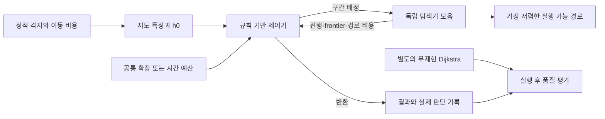

# 구현 설계

## 데이터 흐름

`Grid`는 불변 객체입니다. `Search.step()`은 한 번에 최대 한 노드만 확장하며 `advance()`로 원하는 만큼 수행할 수 있습니다. 모든 전략은 독립 frontier, 비용, 부모, CLOSED 정보를 유지합니다. 힙의 오래된 우선순위 항목은 lazy deletion으로 제거하며 더 좋은 g를 찾으면 갱신·재개방합니다. BFS는 최초 발견 순서로 확장합니다.

`run_agent()`는 특징 계산 전에 타이머를 시작합니다. 탐색기를 보관하는 풀, 전체 예산, 최선 경로, 전략별 정체 구간 수를 관리합니다. 실제 확장 횟수만 공통 예산에서 차감하지만, 초기화·힙 재정렬·경로 복원 등의 시간은 전체 시간에 포함합니다. ARA*의 ImprovePath 단계 경계와 재정렬은 확장으로 세지 않으며 실제 시간에는 포함합니다. 일반 탐색기의 도착 노드 꺼내기도 확장 1회로 셉니다. ARA*는 목표 비용과 OPEN 최저값을 비교하여 도착 노드 확장 없이 인증할 수 있습니다.

## 제어 규칙

초기 선택은 남은 총 확장 예산과 h0의 비율, 실제 장애물 밀도, 지도 크기, 비용 종류를 사용합니다. 관찰 구간에서 최저 휴리스틱 감소량과 frontier 변화를 기록합니다. 진행 감소가 임계값보다 작고 열린 후보가 남아 있으면 정체로 누적합니다. 관찰 구간이 연속으로 정체될 때만 전환하며, 기본 전환 상한은 2회입니다.

빠른 전략이 정체하면 A* 쪽으로, A*가 정체하면 높은 가중치 쪽으로 전환합니다. 경로가 확보되면 A*·Dijkstra를 우선하여 개선합니다. 다시 선택한 탐색기의 기존 상태를 그대로 재개하며 탐색기 간 상태는 공유하지 않습니다. 품질 충분조건, 최적 탐색기의 인증, 낮은 남은 예산과 반복된 개선 부재를 반환 규칙으로 사용합니다.

규칙은 `Rules`에서 한 곳에 관리합니다. 후보 4개를 사전에 정의하고 검증 지도에서 S1.10, 도달률, 총 확장 수 순서로 선정합니다. 검증 선정 결과는 `frozen_rules.json`으로 저장한 뒤 최종 평가에 그대로 사용합니다. 코드와 임계값 변경 후에는 새로운 출력 경로로 전체 평가를 다시 실행해야 합니다.

## ARA*

가중치 3.0에서 시작해 0.5씩 줄입니다. 한 단계에서 확장한 노드는 CLOSED에 둡니다. CLOSED 노드의 비용이 개선되면 INCONS에 저장하고 다음 단계의 OPEN으로 이동합니다. 단계 경계에서는 CLOSED를 비우고 OPEN의 우선순위를 다시 구성합니다. g와 부모 정보는 계속 재사용합니다.

논문의 Figure 3과 같이 목표 g가 OPEN 최저 weighted f 이하인 시점에 해당 단계를 인증합니다. OPEN∪INCONS의 최소 g+h를 사용한 경계를 계산하며 1.0에 도달하면 최적 종료합니다. 예산 도중의 실행 가능한 경로도 보존하지만, 이 중간 경로에 인증된 가중치 경계를 자동 부여하지 않습니다.

## 시뮬레이터

표준 라이브러리 `ThreadingHTTPServer`가 로컬 인터페이스 `127.0.0.1`에서만 제공합니다. 정적 파일은 허용 목록으로 제공하며 `/api/run`이 지도 생성·탐색·사후 비교를 수행합니다. 브라우저는 실제 실행 기록을 재생합니다. 계산 시간과 재생 시간은 별개입니다. 탐색 과정에서 확보한 각 경로는 trace 모드에서만 저장하여 화면의 시간 이동에 사용합니다.

## 확장 범위

현재 제외한 기능은 학습 기반 선택기, 알고리즘 간 탐색 상태 공유, 동적 장애물, 8방향 이동, 실시간 OS 강제 중단입니다. 프로세스 RSS를 측정하는 별도 플랫폼 계측도 후속 기능입니다. 단순한 실행 시간 차감은 제어기가 없었을 때의 실행 결과를 대신하지 않으므로, 최종 비교에는 비용을 포함한 시간을 사용합니다.
