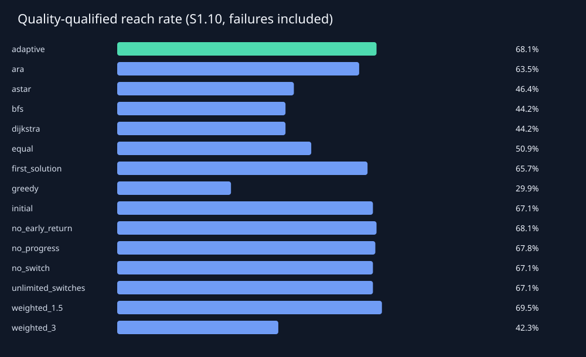
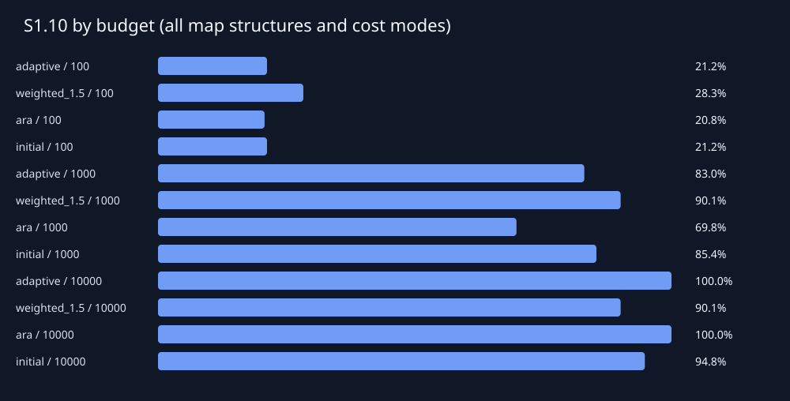
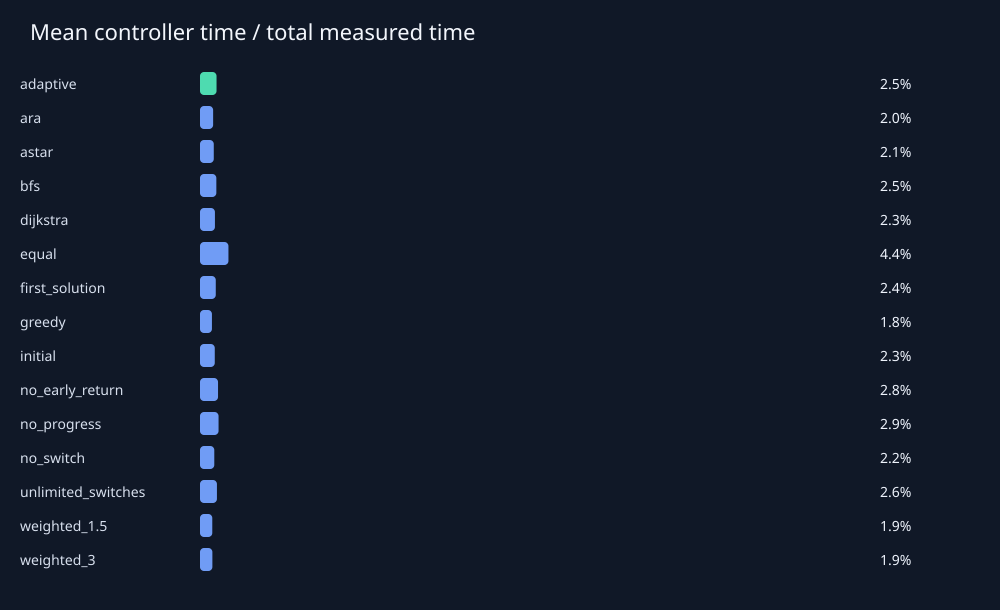

# 실험 결과 보고서

지도 270개, 지도–예산 조합 810개, 실행 12150개.

검증 지도에서 선정하고 최종 평가 전에 고정한 단일 기준선: **weighted_1.5**.

Sρ의 분모는 경로가 존재하는 지도–예산 조합 전체입니다. 예산 내 미발견도 실패로 포함하며, 경로 없는 지도는 별도 집계합니다.

| 방법 | 도달률 | S1.05 | S1.10 | S1.25 | 성공 시 평균 C/C* | 평균 확장 | 평균 시간(ms) |
|---|---:|---:|---:|---:|---:|---:|---:|
| adaptive | 73.11% | 44.50% | 68.08% | 72.96% | 1.034 | 469.131 | 3.815 |
| ara | 77.20% | 52.20% | 63.52% | 77.04% | 1.033 | 953.226 | 7.873 |
| astar | 46.38% | 46.38% | 46.38% | 46.38% | 1.000 | 985.141 | 6.799 |
| bfs | 44.18% | 44.18% | 44.18% | 44.18% | 1.000 | 1294.306 | 6.316 |
| dijkstra | 44.18% | 44.18% | 44.18% | 44.18% | 1.000 | 1294.306 | 7.762 |
| equal | 54.09% | 38.21% | 50.94% | 53.77% | 1.027 | 2059.638 | 13.494 |
| first_solution | 73.11% | 41.35% | 65.72% | 72.80% | 1.039 | 411.754 | 3.477 |
| greedy | 77.36% | 10.22% | 29.87% | 74.06% | 1.114 | 364.316 | 3.058 |
| initial | 74.06% | 41.82% | 67.14% | 74.06% | 1.038 | 367.249 | 3.194 |
| no_early_return | 73.11% | 50.00% | 68.08% | 72.96% | 1.027 | 1530.060 | 9.914 |
| no_progress | 73.58% | 42.77% | 67.77% | 73.43% | 1.037 | 448.491 | 3.702 |
| no_switch | 74.06% | 41.82% | 67.14% | 74.06% | 1.038 | 367.249 | 3.167 |
| unlimited_switches | 73.11% | 43.24% | 67.14% | 72.96% | 1.036 | 570.904 | 4.380 |
| weighted_1.5 | 77.20% | 31.45% | 69.50% | 77.20% | 1.050 | 295.743 | 2.793 |
| weighted_3 | 77.20% | 14.78% | 42.30% | 76.89% | 1.084 | 329.325 | 2.974 |

## 짝지은 비교

차이는 adaptive − 기준선입니다. S1.10 차이가 양수이면 적응형이 유리합니다. 신뢰구간은 지도 단위 95% bootstrap이며 같은 지도의 모든 예산 실행을 함께 재표집합니다.

| 기준선 | ΔS1.10 | 95% CI | 공동 성공 수 | 공동 성공 품질 차이 |
|---|---:|---|---:|---:|
| ara | 4.56% | [2.52%, 6.60%] | 465 | 0.006 |
| astar | 21.70% | [19.65%, 24.06%] | 295 | 0.019 |
| bfs | 23.90% | [21.86%, 25.94%] | 281 | 0.018 |
| dijkstra | 23.90% | [21.86%, 25.94%] | 281 | 0.018 |
| equal | 17.14% | [15.09%, 19.50%] | 342 | -0.002 |
| first_solution | 2.36% | [1.26%, 3.46%] | 465 | -0.005 |
| greedy | 38.21% | [33.65%, 42.77%] | 465 | -0.075 |
| initial | 0.94% | [-0.47%, 2.36%] | 463 | -0.003 |
| no_early_return | 0.00% | [0.00%, 0.00%] | 465 | 0.007 |
| no_progress | 0.31% | [-0.63%, 1.26%] | 460 | -0.002 |
| no_switch | 0.94% | [-0.47%, 2.36%] | 463 | -0.003 |
| unlimited_switches | 0.94% | [0.31%, 1.73%] | 465 | -0.002 |
| weighted_1.5 | -1.42% | [-4.56%, 1.26%] | 465 | -0.015 |
| weighted_3 | 25.79% | [21.54%, 30.50%] | 465 | -0.047 |

이 실행에서 적응형의 S1.10은 검증 선정 기준선보다 **1.42%p 낮았습니다**. 이 결과만으로 일반적 우수성을 주장하지 않습니다.

## 측정 범위와 해석

- 최적 비용은 별도의 무제한 Dijkstra로 계산하며 실행 중 제어기에 전달하지 않았습니다.
- 시간은 특징 계산, 전략 선택, 초기화, 전환, 복원 및 계측 비용을 포함합니다. 지도 생성·평가용 최적 비용 계산·화면 재생은 제외합니다.
- 메모리 지표: retained state estimate; not process RSS. 추정치와 traced allocation peak는 RSS가 아닙니다.
- 시간 제한은 협력적 검사입니다. 한 확장·초기화의 완료와 결과 정리에 따른 초과 시간을 기록하며, 마감 후 완료된 새 경로는 채택하지 않습니다.
- seconds_without_controller는 측정된 제어 시간을 차감한 보조값입니다. 제어기 없이 재실행한 반사실적 성능을 뜻하지 않습니다.
- 무전환 변형은 초기 선택만 유지합니다. no_progress는 지도 특징과 남은 예산만 사용하여 전환합니다.
- no_early_return은 품질·정체 기반 조기 반환을 제거합니다. 모든 유용한 탐색기가 끝나거나 전환 한도에 도달하면 종료할 수 있습니다.
- 전체 평균은 구성한 지도 분포에 의존합니다. 구조별 실제 밀도도 함께 기록했으며 밀도를 통제한 인과 효과를 주장하지 않습니다.
- 세부 조건별 비교와 불리한 조건은 summary_by_condition.csv 및 paired_by_condition.csv에서 확인할 수 있습니다.

