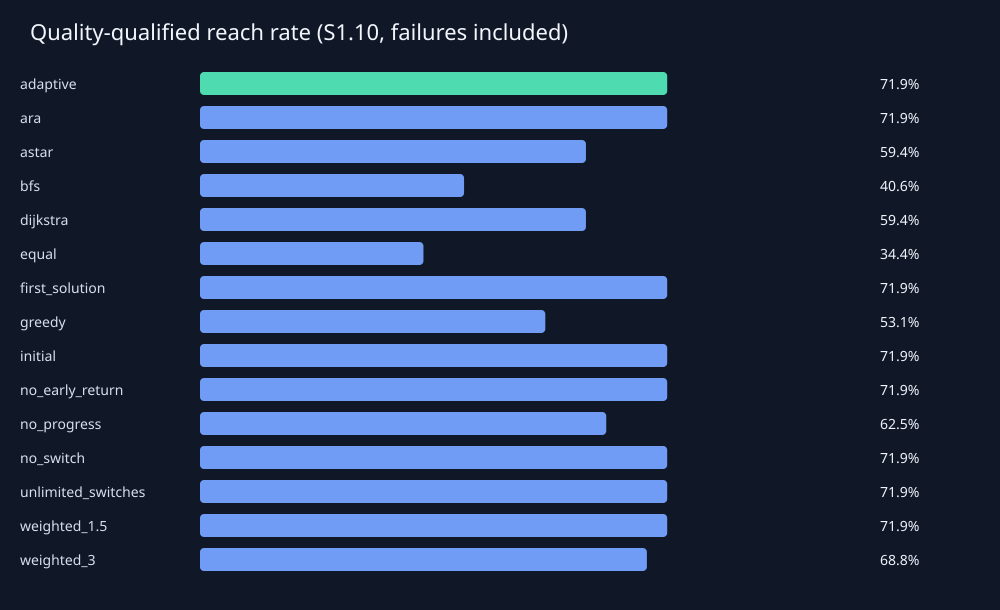
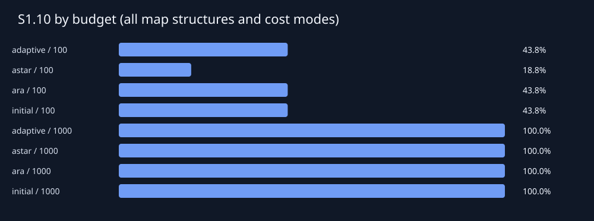
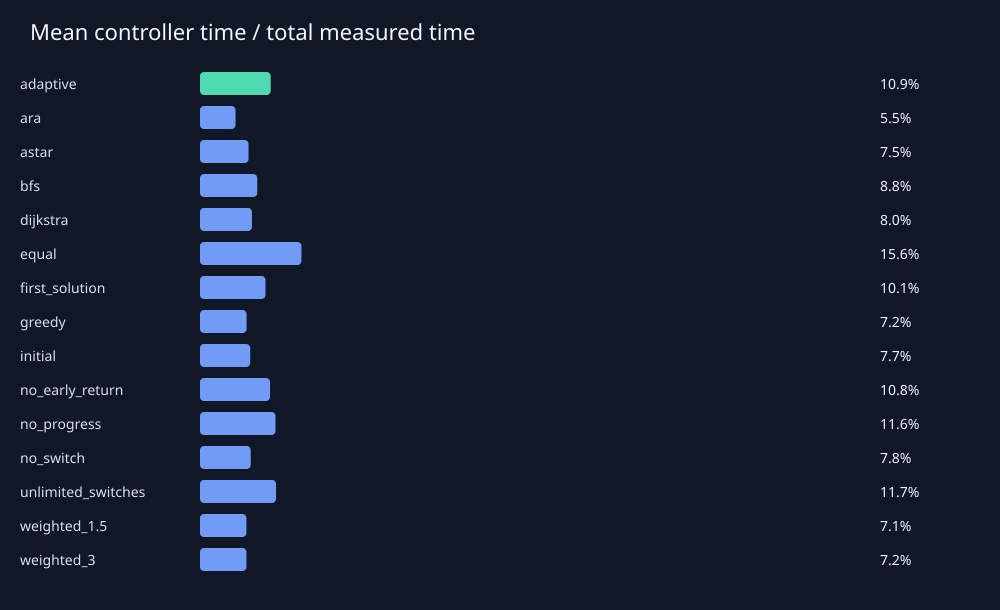

# 실험 결과 보고서

지도 16개, 지도–예산 조합 32개, 실행 480개.

검증 지도에서 선정하고 최종 평가 전에 고정한 단일 기준선: **astar**.

Sρ의 분모는 경로가 존재하는 지도–예산 조합 전체입니다. 예산 내 미발견도 실패로 포함하며, 경로 없는 지도는 별도 집계합니다.

| 방법 | 도달률 | S1.05 | S1.10 | S1.25 | 성공 시 평균 C/C* | 평균 확장 | 평균 시간(ms) |
|---|---:|---:|---:|---:|---:|---:|---:|
| adaptive | 75.00% | 62.50% | 71.88% | 75.00% | 1.019 | 179.625 | 2.951 |
| ara | 75.00% | 65.62% | 71.88% | 75.00% | 1.011 | 157.812 | 3.393 |
| astar | 59.38% | 59.38% | 59.38% | 59.38% | 1.000 | 142.406 | 2.016 |
| bfs | 59.38% | 40.62% | 40.62% | 50.00% | 1.097 | 173.719 | 2.053 |
| dijkstra | 59.38% | 59.38% | 59.38% | 59.38% | 1.000 | 175.656 | 2.203 |
| equal | 37.50% | 34.38% | 34.38% | 37.50% | 1.012 | 479.812 | 10.563 |
| first_solution | 75.00% | 59.38% | 71.88% | 75.00% | 1.024 | 159.469 | 2.581 |
| greedy | 75.00% | 40.62% | 53.12% | 62.50% | 1.098 | 104.312 | 1.532 |
| initial | 75.00% | 62.50% | 71.88% | 75.00% | 1.016 | 120.688 | 1.766 |
| no_early_return | 75.00% | 62.50% | 71.88% | 75.00% | 1.019 | 259.219 | 4.253 |
| no_progress | 65.62% | 56.25% | 62.50% | 65.62% | 1.012 | 175.688 | 2.764 |
| no_switch | 75.00% | 62.50% | 71.88% | 75.00% | 1.016 | 120.688 | 1.786 |
| unlimited_switches | 75.00% | 65.62% | 71.88% | 75.00% | 1.011 | 198.688 | 3.406 |
| weighted_1.5 | 71.88% | 65.62% | 71.88% | 71.88% | 1.011 | 117.031 | 1.713 |
| weighted_3 | 75.00% | 53.12% | 68.75% | 75.00% | 1.029 | 119.562 | 1.821 |

## 짝지은 비교

차이는 adaptive − 기준선입니다. S1.10 차이가 양수이면 적응형이 유리합니다. 신뢰구간은 지도 단위 95% bootstrap이며 같은 지도의 모든 예산 실행을 함께 재표집합니다.

| 기준선 | ΔS1.10 | 95% CI | 공동 성공 수 | 공동 성공 품질 차이 |
|---|---:|---|---:|---:|
| ara | 0.00% | [0.00%, 0.00%] | 24 | 0.008 |
| astar | 12.50% | [3.12%, 21.88%] | 19 | 0.010 |
| bfs | 31.25% | [15.62%, 46.88%] | 19 | -0.087 |
| dijkstra | 12.50% | [3.12%, 21.88%] | 19 | 0.010 |
| equal | 37.50% | [28.12%, 46.88%] | 12 | -0.003 |
| first_solution | 0.00% | [0.00%, 0.00%] | 24 | -0.005 |
| greedy | 18.75% | [6.25%, 31.25%] | 24 | -0.079 |
| initial | 0.00% | [0.00%, 0.00%] | 24 | 0.003 |
| no_early_return | 0.00% | [0.00%, 0.00%] | 24 | 0.000 |
| no_progress | 9.38% | [0.00%, 18.75%] | 21 | 0.009 |
| no_switch | 0.00% | [0.00%, 0.00%] | 24 | 0.003 |
| unlimited_switches | 0.00% | [0.00%, 0.00%] | 24 | 0.008 |
| weighted_1.5 | 0.00% | [-9.38%, 9.38%] | 23 | 0.009 |
| weighted_3 | 3.12% | [0.00%, 9.38%] | 24 | -0.011 |

이 실행에서 적응형의 S1.10은 검증 선정 기준선보다 **12.50%p 높았습니다**. 이 결과만으로 일반적 우수성을 주장하지 않습니다.

## 측정 범위와 해석

- 최적 비용은 별도의 무제한 Dijkstra로 계산하며 실행 중 제어기에 전달하지 않았습니다.
- 시간은 특징 계산, 전략 선택, 초기화, 전환, 복원 및 계측 비용을 포함합니다. 지도 생성·평가용 최적 비용 계산·화면 재생은 제외합니다.
- 메모리 지표: tracemalloc allocation peak (instrumented timing). 추정치와 traced allocation peak는 RSS가 아닙니다.
- 시간 제한은 협력적 검사입니다. 한 확장·초기화의 완료와 결과 정리에 따른 초과 시간을 기록하며, 마감 후 완료된 새 경로는 채택하지 않습니다.
- seconds_without_controller는 측정된 제어 시간을 차감한 보조값입니다. 제어기 없이 재실행한 반사실적 성능을 뜻하지 않습니다.
- 무전환 변형은 초기 선택만 유지합니다. no_progress는 지도 특징과 남은 예산만 사용하여 전환합니다.
- no_early_return은 품질·정체 기반 조기 반환을 제거합니다. 모든 유용한 탐색기가 끝나거나 전환 한도에 도달하면 종료할 수 있습니다.
- 전체 평균은 구성한 지도 분포에 의존합니다. 구조별 실제 밀도도 함께 기록했으며 밀도를 통제한 인과 효과를 주장하지 않습니다.
- 세부 조건별 비교와 불리한 조건은 summary_by_condition.csv 및 paired_by_condition.csv에서 확인할 수 있습니다.

