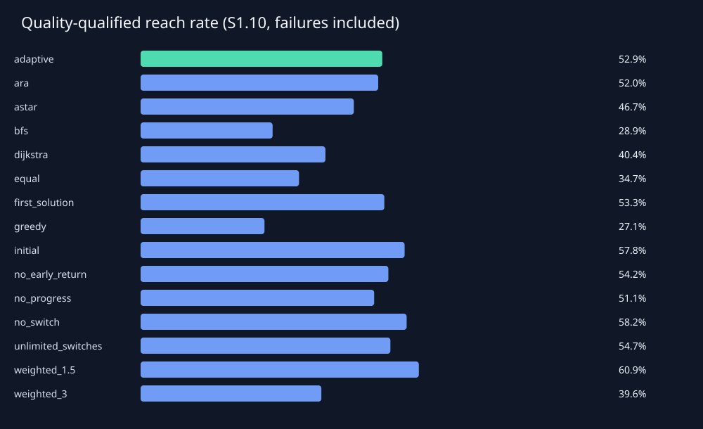
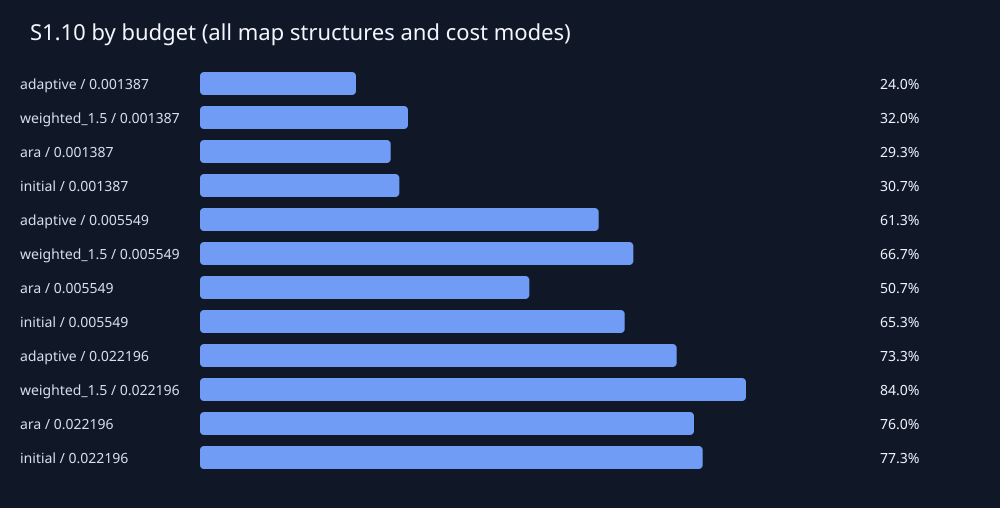
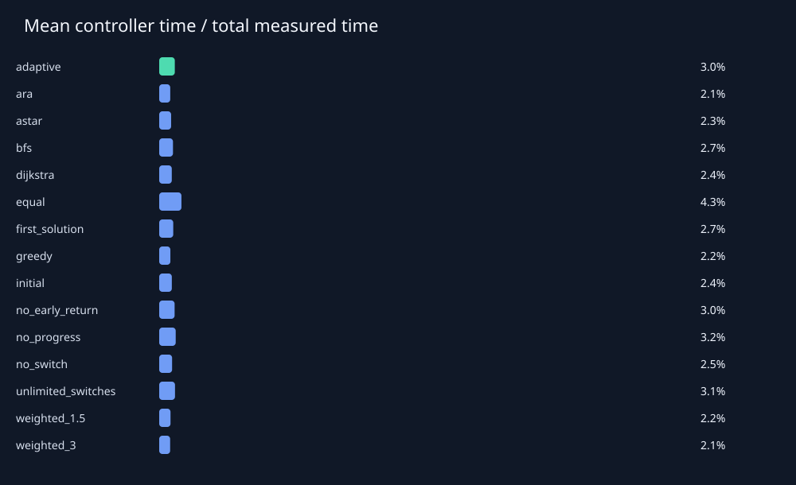

# 실험 결과 보고서

지도 90개, 지도–예산 조합 270개, 실행 4050개.

검증 지도에서 선정하고 최종 평가 전에 고정한 단일 기준선: **weighted_1.5**.

Sρ의 분모는 경로가 존재하는 지도–예산 조합 전체입니다. 예산 내 미발견도 실패로 포함하며, 경로 없는 지도는 별도 집계합니다.

| 방법 | 도달률 | S1.05 | S1.10 | S1.25 | 성공 시 평균 C/C* | 평균 확장 | 평균 시간(ms) |
|---|---:|---:|---:|---:|---:|---:|---:|
| adaptive | 59.11% | 43.11% | 52.89% | 58.67% | 1.031 | 734.667 | 4.728 |
| ara | 70.22% | 44.89% | 52.00% | 68.89% | 1.048 | 716.193 | 5.363 |
| astar | 46.67% | 46.67% | 46.67% | 46.67% | 1.000 | 773.530 | 4.859 |
| bfs | 45.78% | 27.56% | 28.89% | 28.89% | 1.180 | 1084.344 | 4.857 |
| dijkstra | 40.44% | 40.44% | 40.44% | 40.44% | 1.000 | 910.393 | 5.191 |
| equal | 40.44% | 28.00% | 34.67% | 39.11% | 1.039 | 1211.985 | 7.618 |
| first_solution | 60.44% | 41.78% | 53.33% | 60.00% | 1.035 | 572.067 | 3.974 |
| greedy | 68.44% | 21.33% | 27.11% | 45.33% | 1.258 | 510.181 | 3.667 |
| initial | 61.78% | 47.11% | 57.78% | 61.78% | 1.023 | 544.011 | 4.016 |
| no_early_return | 60.00% | 44.89% | 54.22% | 59.56% | 1.029 | 951.333 | 5.904 |
| no_progress | 57.78% | 41.78% | 51.11% | 57.33% | 1.031 | 748.559 | 4.979 |
| no_switch | 62.22% | 47.56% | 58.22% | 62.22% | 1.023 | 545.800 | 3.755 |
| unlimited_switches | 59.56% | 44.89% | 54.67% | 59.11% | 1.027 | 780.826 | 5.019 |
| weighted_1.5 | 65.33% | 46.67% | 60.89% | 65.33% | 1.027 | 506.426 | 3.672 |
| weighted_3 | 66.22% | 24.44% | 39.56% | 62.67% | 1.085 | 516.433 | 3.584 |

## 짝지은 비교

차이는 adaptive − 기준선입니다. S1.10 차이가 양수이면 적응형이 유리합니다. 신뢰구간은 지도 단위 95% bootstrap이며 같은 지도의 모든 예산 실행을 함께 재표집합니다.

| 기준선 | ΔS1.10 | 95% CI | 공동 성공 수 | 공동 성공 품질 차이 |
|---|---:|---|---:|---:|
| ara | 0.89% | [-4.89%, 7.56%] | 133 | -0.007 |
| astar | 6.22% | [-0.89%, 12.89%] | 96 | 0.012 |
| bfs | 24.00% | [15.11%, 32.44%] | 91 | -0.171 |
| dijkstra | 12.44% | [5.33%, 19.11%] | 83 | 0.011 |
| equal | 18.22% | [14.22%, 22.22%] | 90 | -0.009 |
| first_solution | -0.44% | [-3.11%, 1.78%] | 132 | -0.004 |
| greedy | 25.78% | [15.56%, 34.67%] | 132 | -0.233 |
| initial | -4.89% | [-10.22%, 0.00%] | 129 | 0.004 |
| no_early_return | -1.33% | [-3.56%, 0.44%] | 131 | 0.002 |
| no_progress | 1.78% | [-2.22%, 5.33%] | 123 | -0.000 |
| no_switch | -5.33% | [-10.22%, -0.44%] | 128 | 0.004 |
| unlimited_switches | -1.78% | [-5.33%, 1.78%] | 127 | 0.003 |
| weighted_1.5 | -8.00% | [-12.89%, -3.11%] | 131 | 0.003 |
| weighted_3 | 13.33% | [5.78%, 20.00%] | 132 | -0.051 |

이 실행에서 적응형의 S1.10은 검증 선정 기준선보다 **8.00%p 낮았습니다**. 이 결과만으로 일반적 우수성을 주장하지 않습니다.

## 측정 범위와 해석

- 최적 비용은 별도의 무제한 Dijkstra로 계산하며 실행 중 제어기에 전달하지 않았습니다.
- 시간은 특징 계산, 전략 선택, 초기화, 전환, 복원 및 계측 비용을 포함합니다. 지도 생성·평가용 최적 비용 계산·화면 재생은 제외합니다.
- 메모리 지표: retained state estimate; not process RSS. 추정치와 traced allocation peak는 RSS가 아닙니다.
- 시간 제한은 협력적 검사입니다. 한 확장·초기화의 완료와 결과 정리에 따른 초과 시간을 기록하며, 마감 후 완료된 새 경로는 채택하지 않습니다.
- seconds_without_controller는 측정된 제어 시간을 차감한 보조값입니다. 제어기 없이 재실행한 반사실적 성능을 뜻하지 않습니다.
- 무전환 변형은 초기 선택만 유지합니다. no_progress는 지도 특징과 남은 예산만 사용하여 전환합니다.
- no_early_return은 품질·정체 기반 조기 반환을 제거합니다. 모든 유용한 탐색기가 끝나거나 전환 한도에 도달하면 종료할 수 있습니다.
- 전체 평균은 구성한 지도 분포에 의존합니다. 구조별 실제 밀도도 함께 기록했으며 밀도를 통제한 인과 효과를 주장하지 않습니다.
- 세부 조건별 비교와 불리한 조건은 summary_by_condition.csv 및 paired_by_condition.csv에서 확인할 수 있습니다.

